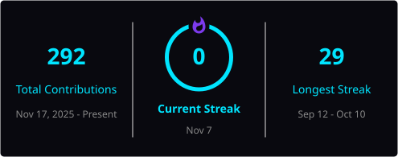

# ⚡ ANMOL KUMAR

<div align="center">


<br/>

**💫 Always learning, Always improving.**

</div>

---

<h2 align="center">⚡ 01 / ABOUT_ME</h2>

```java
public class AnmolKumar {

    private final String name = "Anmol Kumar";
    private final String university = "VIT Bhopal University";
    private final String degree = "B.Tech";
    private final String role = "Aspiring Software Developer";

    private final String[] interests = {
        "Java Programming",
        "Web Development",
        "Problem Solving",
        "Technology"
    };

    private final String motto =
        "Always learning, Always improving.";

    public void introduce() {
        System.out.println("Turning curiosity into code!");
    }

    public static void main(String[] args) {
        AnmolKumar developer = new AnmolKumar();
        developer.introduce();
    }
}
```

I'm a B.Tech student at **VIT Bhopal University**, passionate about programming, technology, and building solutions to real-world problems.

I enjoy exploring how software works, experimenting with different technologies, and continuously improving my coding skills.

- 🎓 Pursuing B.Tech at VIT Bhopal University.
- 💻 Building a strong foundation in programming.
- 🌱 Exploring software and web development.
- 🧠 Interested in problem-solving and logical thinking.
- 🚀 Learning by experimenting and building projects.

---

<h2 align="center">⚡ 02 / TECH_STACK</h2>

<p align="center"><b>PROGRAMMING LANGUAGES</b></p>

<p align="center">
  
</p>

<p align="center"><b>FRAMEWORKS & TECHNOLOGIES</b></p>

<p align="center">
  
</p>

---

<h2 align="center">⚡ 03 / DEVELOPER_MINDSET</h2>

```java
public class DeveloperMindset {

    public static void main(String[] args) {

        String[] dailyGoals = {
            "Learn something new",
            "Write better code",
            "Solve challenging problems",
            "Build meaningful projects",
            "Improve every day"
        };

        for (String goal : dailyGoals) {
            System.out.println("[+] " + goal);
        }

        System.out.println(
            "\n>> Always learning, Always improving."
        );
    }
}
```

<div align="center">

**THINK → CODE → DEBUG → CREATE → REPEAT**

</div>

---

<h2 align="center">📊 04 / GITHUB_ANALYTICS</h2>

<p align="center">
  <i>Repository insights and programming language distribution.</i>
</p>

<p align="center">
  
  
</p>

---

<h2 align="center">🔥 05 / CONTRIBUTION_STREAK</h2>

<p align="center">
  <i>Consistency is the key to becoming a better developer.</i>
</p>

<div align="center">



<br/>

<sub>Current streak · Longest streak · Contributions this year</sub>

</div>

---

<h2 align="center">⚡ 06 / CONTRIBUTION_ACTIVITY</h2>

<p align="center">
  <i>Every contribution is another step forward.</i>
</p>

<div align="center">

<picture>
  <source media="(prefers-color-scheme: dark)" srcset="./dist/github-snake-dark.svg" />
  <source media="(prefers-color-scheme: light)" srcset="./dist/github-snake.svg" />
  
</picture>

</div>

---

<h2 align="center">🏆 07 / DEVELOPER_MILESTONES</h2>

<div align="center">

| Milestone | Focus |
|:---|:---|
| `01` | Programming fundamentals |
| `02` | Java development |
| `03` | Web technologies |
| `04` | Problem solving |
| `05` | Building real-world projects |

</div>

---

<h2 align="center">🌐 08 / CONNECT_WITH_ME</h2>

<p align="center">
  <i>Open to learning, collaboration, and new opportunities.</i>
</p>

<p align="center">
  <a href="https://linkedin.com/in/anmol-kumar-6b3897384">
    
  </a>
  &nbsp;
  <a href="mailto:anmol.kumar.sk49@gmail.com">
    
  </a>
</p>

---

<h2 align="center">👁️ 09 / PROFILE_VISITORS</h2>

<p align="center">
  
</p>

<br/>

<div align="center">

### `while (alive) { learn(); build(); improve(); }`

# 💫 Always learning, Always improving.

<sub>Designed with curiosity. Powered by code. Driven by consistency.</sub>

<br/><br/>


</div>

<!-- END OF PROFILE README -->
